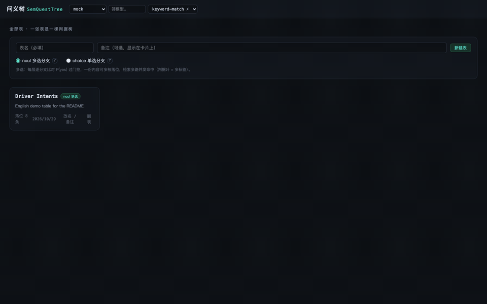

[简体中文](README.zh-CN.md) | [English](README.md)

# SemQuestTree 问义树

  

**Search without embeddings.** Your knowledge becomes a tree of criteria; a decision model walks content down the tree layer by layer — `add` files it into leaves, `quest` retrieves by natural language. Every hit carries its full decision path: which criteria fired, at what probability, at what token cost.

- **Explainable** — a readable decision path with P(yes) trace, not a black-box similarity score
- **Multi-label** — one utterance lands in several leaves at once (noul mode); single-path descent also available (choice mode)
- **Human-steerable** — criteria are configuration: edit them in the UI, per-subtree rule overrides, effective on save
- **Zero infrastructure** — no embedding model, no vector DB, no indexer; JDK 8+ and it runs
- **Visual** — built-in server: expand trees, click nodes, edit criteria, hot-swap models, query console

Good fit: FAQ / policy lookup, ticket triage, intent routing — any small-to-medium index a human must read and control.



## What a table looks like

One table = one criteria tree. The demo from the GIF, built with a handful of HTTP API POSTs:

```
ROOT
├── Fare     ── surge / lowball / unpaid
├── Cargo    ── damaged / loading
├── Schedule ── late / cancel
└── Service  ── complaint / praise / contact
```

Every node carries a yes criterion (an event-level atomic assertion); leaves hold the placed docs; every layer grows an `X_OTHER` fallback leaf. `add` and `quest` descend the same tree — the decision model answers one batched noul question per layer, and anything below the gate falls to that layer's fallback:

| content / query | descends via | lands in |
| --- | --- | --- |
| `This Fare is a pure lowball for 40 km, please raise it.` | Fare → lowball | lowball |
| `The ride is done but the Fare is still unpaid, I need that money.` | Fare → unpaid | unpaid |
| `driver says the Fare is unpaid and the Cargo arrived damaged` *(query)* | Fare→unpaid ∥ Cargo→damaged | unpaid + damaged |

Retrieval score = number of hit leaves; the GIF shows this third query returning two documents through two leaves, with the full per-layer probability trace.

## Up and running in 60 seconds (no credentials)

```bash
git clone https://github.com/LEERYx/SemQuestTree.git
cd SemQuestTree
javac -encoding UTF-8 -d target/classes $(find src/main/java -name "*.java")   # Windows: use Git Bash / WSL
java -cp target/classes org.example.SemQuestServer
```

- No credentials configured → the server falls back to the built-in **mock backend** (zero tokens, zero network). Open http://localhost:8787 — the demo table 司机意图 migrates automatically; open its 控制台 → 检索 and try `找运费价格相关：要求涨价、讨要运费的话术`
- English demo table (the GIF's Driver Intents): `java -cp target/classes org.example.SemQuestClient seed`
- Real models: copy `semquest.properties.example` → `semquest.properties`, see [Configuration](#configuration)

## Running the visualization server

Compile + start is the command block above; stop everything with:

```bash
pkill -f org.example.SemQuestServer
```

If upstream decision endpoints are region-blocked, append `-Dhttps.proxyHost=127.0.0.1 -Dhttps.proxyPort=7890` (adjust the port) to the `java` command; more in **[docs/TROUBLESHOOTING.md](docs/TROUBLESHOOTING.md)**.

At http://localhost:8787 :

- Start page: all tables as cards — 新建表 (name + branch mode noul / choice + note, fixed at creation), 改名 / 备注 / 删表
- Left-click a node to expand one layer; 全部展开 pulls the whole tree; click a node → the right panel shows path, criteria and placed docs (internal nodes add the subtree's docs, 10 at a time)
- Right-click → 增加判断节点 / 增加选项: creating a branch re-judges the parent's existing docs into it; 修改节点 edits name / criteria with zero model calls; 删除节点 removes the subtree and its placements (root and fallback leaves protected)
- Header model bar (all tables): pick backend jev / openrouter / 百炼 / mock, then a model — selecting hot-swaps instantly; ⚡ = decision-endpoint models, ·免费 = free
- 控制台 tab, two modes (Enter runs, Shift+Enter newlines): 落位 add places one line of content (paste several → batch), 检索 search returns hit leaves, ranked docs, decision trace and token bill; repeating the exact same query returns the cached result (⚡, zero model calls)
- Top-right parameter box: 门控 (noul gate) / 采纳线 (choice acceptance line) — runtime-adjustable, persisted per table, never re-ranks placed data
- EN / 中文 switches the UI language

Each table persists at `tables/<id>.json` (structure, criteria, gates, placements, growth / edit records); restart reads the snapshot with zero model calls. `--reseed` rebuilds only demo tables from the schema (calls the model):

```bash
java -cp target/classes org.example.SemQuestServer --reseed
```

## Console demo (optional)

```bash
java -cp target/classes org.example.Demo
java -cp target/classes org.example.Demo mock        # pick a backend (mock | jev | openrouter | bailian)
java -cp target/classes org.example.Demo jev 0.7     # backend + gate
```

Prints add placement traces, quest hits and the token bill.

## HTTP API & Java client

The visualization server is itself a full REST API — every endpoint documented in **[docs/API.md](docs/API.md)**. A zero-dependency Java client ships in [`org.example.SemQuestClient`](src/main/java/org/example/SemQuestClient.java): copy it with `Json.java` into your backend and call any endpoint; credentials stay server-side:

```bash
java -cp target/classes org.example.SemQuestClient                    # demo: create table → branches → docs → retrieve → drop; ~6 real decision calls, switch to mock for zero cost
java -cp target/classes org.example.SemQuestClient http://localhost:8790   # custom address
```

## Configuration

All configuration lives in `semquest.properties` (start by copying [`semquest.properties.example`](semquest.properties.example); the real credentials file is excluded by `.gitignore`). Priority: `-Dsemquest.KEY=...` > config file > code defaults.

**Two providers' API keys are currently supported: jev and OpenRouter** — apply on their platforms and fill the keys in the config file. Bailian has no decision model available yet; it will be adapted once one ships (its config entries are kept for then). For a no-credential experience use `backend=mock`.

| Key | Meaning |
| --- | --- |
| `backend` | mock \| jev \| openrouter \| bailian (jev without a key falls back to openrouter, then to mock; mock always works with no credentials) |
| `noulGate` | noul gate, default 0.7 (initial value for new noul tables; adjustable per table from the header) |
| `choiceGate` | choice acceptance line, default 0.6 (initial value for new choice tables; adjustable per table from the header) |
| `prompt.*` | decision prompts (server-composed wording), add (placement) and search (retrieval) each with their own set: `prompt.rule.add` / `prompt.rule.search` (state rule; default for new tables — a hot reload swaps only tables still carrying the previous default text, customized ones are untouched), `prompt.noul.add.instructions` / `prompt.noul.search.instructions` ({name} = branch name), `prompt.noul.add.criterion` / `prompt.noul.search.criterion` ({yes} = raw criterion, {name} = branch name; wraps the criterion text before judging — add defaults to identity `{yes}`, search defaults to a retrieval frame so generic queries like "all sad utterances" can pass mechanism-description criteria), `prompt.choice.add.root` / `prompt.choice.add.node` / `prompt.choice.search.root` / `prompt.choice.search.node` ({node} = node name, ROOT layer uses the root key), `prompt.choice.other` (fallback option description); delete the line or leave it blank for the built-in default |
| `questCacheSize` | query-result cache capacity (entries), default 256; 0 = off; identical queries return with zero model calls; hot-reloaded on config save |
| `schema` | demo table migration source, default driver-intent-schema.json |
| `timeoutMs` | per-request timeout in milliseconds |
| `server.port` / `server.tables` / `server.data` / `server.viz` | server port / tables dir / legacy data file (migration) / page file (restart required) |
| `jev.*` / `openrouter.*` | the two decision-model providers' url / model / apikey (bring your own keys) |
| `bailian.*` | Bailian url / model / apikey (no decision model available yet; adapted once it ships) |
| `mock.model` | display id of the mock backend model, default keyword-match |
| `jev.models` / `openrouter.models` / `bailian.models` | manual model lists (comma-separated; when set they take priority; empty = fetch live from upstream) |

Hot reload: the server polls `semquest.properties` every 2 s — **saving the file applies it at once**: `noulGate` / `choiceGate` / `questCacheSize` / `prompt.*` (prompt changes also clear the query caches; `prompt.rule.*` swaps only tables still carrying the previous default text), plus timeout, credentials, per-backend url / model and model lists (changed credentials rebuild the backend, zero inference). Restart required: `server.*`, `schema`, initial `backend`.

## Conventions

- All-Chinese, four layers deep: rules (ruleAdd / ruleSearch), inputs, options and true-false criteria; criteria are event-level atomic assertions; empty `no` auto-generates the negation side; subtrees may override the rules; English backup: `driver-intent-schema.en.json`
- noul tables: one batched question per layer over all real criteria; every branch with P(yes) ≥ gate descends (multi-label); fallback leaves (`X_OTHER`) are excluded from decision requests — zero passes at a layer falls to that layer's fallback; retrieval mirrors the same condition (a hit node with data never returns empty); score = number of hit leaves
- Query cache: the exact same query returns the cached result with zero model calls (⚡); LFU eviction; capacity `questCacheSize` (default 256, 0 = off); any table change clears it; memory-only
- choice tables: one question per layer; options = children (description doubles as criterion, defaulting to the name) + the explicit fallback 以上都不符合; a win below choiceGate falls to the fallback; single path; score = product of path probabilities — fallback or below-line ends with no hit
- Fallback grows with the layer: the first branch at a layer auto-creates its fallback leaf; deleting a layer's last branch removes an empty fallback (refused while it holds placements)
- Mock backend: deterministic keyword substring match (content contains the node name → P = 0.95); for demos / tests only, not real judgment
- Chinese test corpus: `corpus-zh-test.md` (20 utterances with expected-hit annotations)
- respan-family models (free): state uses the `{input,output}` message protocol and only noul is accepted (jev-style three-part criteria dialect); choice tables fail fast with a clear error — switch to a jev / elephant family model

## License

[MIT](LICENSE)
