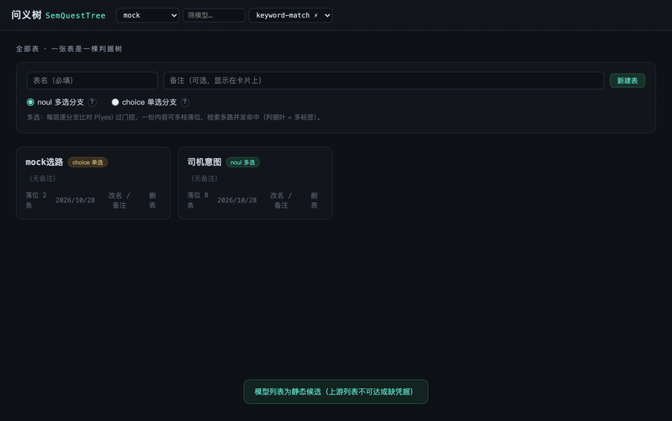

[简体中文](README.zh-CN.md) | [English](README.md)

# 问义树 SemQuestTree

  

**决策模型驱动的多表语义检索器：一张表是一棵判据树。** 不做向量、不建倒排——把领域知识写成一棵「事件级原子断言」的判据树，让决策模型（noul / choice 题型）沿树逐层判定：`add` 把内容沿判据下行落到叶子，`quest` 用自然语言查询检索。

noul 模式多选分支——一份内容可同时命中多个分支，检索多路并发、按命中叶数排序；choice 模式单选分支——每层一个问题只挑一个胜出选项，沿单路径逐层下行。附可视化服务：开始页管理全部表（新建表选分支方式），表内逐层展开、点节点看详情、右键加/改/删节点、后端/模型热切换、落位与检索控制台。



## 为什么不是向量检索

- **路径可解释**：每次命中有显式判定路径与 P(yes) 轨迹（经由哪些判据、每层概率多少、花了多少 token），不是黑盒相似度
- **人可编辑可干预**：判据即配置；子树规则（ruleAdd / ruleSearch）可覆盖全局规则，改判据保存即生效
- **多标签天然成立**：noul 绝对门控下一条内容可落多叶，不需要 top-k 截断
- **零依赖零基建**：无嵌入模型、无向量库、无索引进程，JDK 8+ 编译即跑

适合：FAQ / 政策条款定位、工单分流、意图路由、小中规模、人要看得懂管得住的知识索引。

## 60 秒开箱（零凭据）

```bash
git clone https://github.com/LEERYx/SemQuestTree.git
cd SemQuestTree
javac -encoding UTF-8 -d target/classes $(find src/main/java -name "*.java")   # Windows 请在 Git Bash / WSL 下执行
java -cp target/classes org.example.SemQuestServer
```

打开 http://localhost:8787 ——未配置任何模型凭据时自动落到 **mock 后端**（确定性关键词匹配，零 token、零网络）：demo 表「司机意图」已随仓库自动迁移生成（7 条司机话术）。进入表后点右侧「控制台」→「检索 search」，输入 `找运费价格相关：要求涨价、讨要运费的话术`，即可看到多叶命中、排序文档与判定轨迹。接真实模型见[配置](#配置)（从 `semquest.properties.example` 复制起步）。

## 启动可视化服务

在 SemQuestTree 目录下，编译 + 启动：

```bash
mkdir -p target/classes && javac -encoding UTF-8 -d target/classes $(find src/main/java -name "*.java") \
     && java -cp target/classes org.example.SemQuestServer
```

已编译过则直接启动：

```bash
java -cp target/classes org.example.SemQuestServer
```

停止服务（终止本机全部 SemQuestServer 进程）：

```bash
pkill -f org.example.SemQuestServer
```

提示：上游决策端点被区域封锁时，给 `java` 追加 `-Dhttps.proxyHost=127.0.0.1 -Dhttps.proxyPort=7890`（按本机代理端口改）。凭据与额度、端口、编译、检索行为等常见问题统一见 **[docs/TROUBLESHOOTING.md](docs/TROUBLESHOOTING.md)**。

打开 http://localhost:8787 ：

- 开始页列出全部表（卡片：名称 / 模式 / 备注 / 落位数）；「新建表」填命名 + 分支方式（noul 多选 / choice 单选，鼠标悬停问号有说明）+ 备注，mode 建表时定死不可后改；卡片「改名 / 备注」改表名与备注（表内右上角 ✎ 同款，重名 400，随表落盘）；卡片「删表」删除整棵树与数据文件
- 进入表后初始只显示 ROOT，左键点节点展开一层（每层一次查询），「全部展开」一次拉全树
- 点任意节点 → 右侧显示该节点的路径、判据与落位数据（内部节点另含子节点列表与子树落位合计；不点不显示）
- 右键节点 →「增加判断节点 / 增加选项」：noul 填 name / yes / no 判据（中文），choice 填选项名 + 可选描述；创建后自动把父节点相关存量逐条重判回填，过门/胜出迁入新叶
- 右键节点 →「修改节点 / 修改选项」：改名称与判据，零模型调用；改名连带更新落位指针，修改记录随快照持久化、重启自动回放
- 头部模型栏（全局，对所有表生效）：先选后端（jev / openrouter / 百炼 / mock），拉对应模型列表（openrouter 上游按决策模态实时过滤，官方新模型自动出现；拉不到/超时回内置 32 款候选；配置了 `*.models` 手动清单则直接用清单）。`⚡` 为决策端点模型，`·免费` 为免费模型；选定即热切换（只换凭据通道，不发起推理）
- 头部右上「EN / 中文」按钮切换界面语言（全量翻译，选择记忆在浏览器）
- 右侧「控制台」页签双模式（Enter 触发，Shift+Enter 换行）：`落位 add` 粘一条内容落位到叶（同 ID 重落替换旧落位），一次粘多行即走 `addBatch` 批量落位（逐条隔离，单条失败不影响其余，单批上限 500）；`检索 search` 输入自然语言查询，返回命中叶、排序文档（含正文与 via 路径）、判定轨迹与 token 账单——同一条查询再次检索即缓存直出（标 ⚡，零模型调用），noul / choice 均生效
- 右键节点 →「删除节点」：确认后删除其整个子树（含各级兜底叶）并清理相关落位数据，持久化与增长记录同步更新（根节点与兜底叶不可直接删除）
- 右上角参数框按表模式显示：noul 表为「门控」（运行时调整绝对门控），choice 表为「采纳线」（胜出置信度低于此值落兜底）；只影响其后的判定，不重排已落位数据，调整随表落盘

每张表持久化在 `tables/<id>.json`（结构、判据、双门控、落位、增长与修改记录），重启零模型调用直读快照。旧版单树文件（`driver-intent-schema.json` + `tree-data.json`）在 `tables/` 为空时首启自动迁移为 demo 表「司机意图」。`--reseed` 只重播 demo 表（schema 重建干净树 + Demo.DOCS 重新落位，调模型），非 demo 表不动；全新安装启动为空表栏，零模型调用：

```bash
java -cp target/classes org.example.SemQuestServer --reseed
```

## 跑控制台 Demo（可选）

```bash
java -cp target/classes org.example.Demo
java -cp target/classes org.example.Demo mock        # 指定后端（mock | jev | openrouter | bailian）
java -cp target/classes org.example.Demo jev 0.7     # 指定后端 + 门控
```

打印 add 落位轨迹、quest 检索命中与 token 账单。

## HTTP API 与 Java 客户端

可视化服务本身就是一套 REST API——建表、管树、落位、检索、热切换模型全部走 HTTP，端点入出参详见 **[docs/API.md](docs/API.md)**。仓库自带零依赖 Java 客户端 [`org.example.SemQuestClient`](src/main/java/org/example/SemQuestClient.java)：连同 `Json.java` 两个文件拷进你的 Java 后端即可调用全部接口，决策模型凭据只需存在于服务端，客户端零配置：

```bash
java -cp target/classes org.example.SemQuestClient                    # 默认 http://localhost:8787
java -cp target/classes org.example.SemQuestClient http://localhost:8790   # 指定地址
```

`main()` 完整演示建表 → 加分支 → 落位 → 检索 → 调门控 → 删表（可重复运行，结束自动删演示表）；注意 add/quest 会对当前后端发起真实判定（约 6 次请求），零成本演示先把后端切到 mock。

## 配置

全部配置集中在 `semquest.properties`（从 [`semquest.properties.example`](semquest.properties.example) 复制起步；真实凭据文件已被 `.gitignore` 排除），优先级：`-Dsemquest.KEY=...` > 配置文件 > 代码默认。

**决策模型 API key 目前支持两家：jev 与 OpenRouter**，需自行到对应平台申请并在配置文件填写；百炼暂未开放决策模型，待其上线后再适配（配置项先保留备用）。零凭据体验用 `backend=mock`。

| 配置 | 说明 |
| --- | --- |
| `backend` | mock \| jev \| openrouter \| bailian（jev 缺 key 自动回退 openrouter，再缺落到 mock；mock 恒可用零凭据） |
| `noulGate` | noul 门控，默认 0.7（新建 noul 表的初始值；表内右上角可按表调整） |
| `choiceGate` | choice 采纳线，默认 0.6（新建 choice 表的初始值；表内右上角可按表调整） |
| `prompt.*` | 判定提示词（系统侧组装文案），add（落位）与 search（检索）各一套：`prompt.rule.add` / `prompt.rule.search`（state 规则；新表默认值——热载只置换规则仍等于上次默认文本的表，已自定义的不动）、`prompt.noul.add.instructions` / `prompt.noul.search.instructions`（{name}=分支名）、`prompt.noul.add.criterion` / `prompt.noul.search.criterion`（{yes}=判据原文、{name}=分支名；判定前对判据文本套模板——add 默认恒等 `{yes}`，search 默认包检索框架，让「所有悲伤的话」这类泛查询能过机制描述型判据）、`prompt.choice.add.root` / `prompt.choice.add.node` / `prompt.choice.search.root` / `prompt.choice.search.node`（{node}=层节点名，ROOT 层用 root 键）、`prompt.choice.other`（兜底选项描述）；删行或留空回内置默认 |
| `questCacheSize` | 查询结果缓存容量（条），默认 256；0=关闭；同款查询零模型直返，保存配置热载 |
| `schema` | demo 表迁移来源，默认 driver-intent-schema.json |
| `timeoutMs` | 单请求超时（毫秒） |
| `server.port` / `server.tables` / `server.data` / `server.viz` | 服务端口 / 表目录 / 旧版数据文件（迁移用） / 页面文件（重启生效） |
| `jev.*` / `openrouter.*` | 决策模型两家的 url / model / apikey（key 自行申请） |
| `bailian.*` | 百炼 url / model / apikey（暂未开放决策模型，上线后适配） |
| `mock.model` | mock 后端模型 id 展示名，默认 keyword-match |
| `jev.models` / `openrouter.models` / `bailian.models` | 手动模型清单（逗号分隔；配置即清单优先生效，留空回上游实时拉取） |

配置热载：服务内 2s 轮询 `semquest.properties` 的修改时间，**保存文件即生效**——`noulGate` 应用到全部 noul 表、`choiceGate` 应用到全部 choice 表、`questCacheSize` 与 `prompt.*` 应用到全部表（提示词热载同时清空各表查询缓存；`prompt.rule.*` 只置换树级规则仍等于上次应用文本的表，自定义过的规则不动），超时、凭据、模型清单、各后端 url / model 全部热载（改凭据自动重建当前后端，零推理调用；日志打印 `[热载]` 行）。涉及部署硬性数据的项需重启：`server.port` / `server.tables` / `server.data` / `server.viz`、`schema`、`backend` 首选。

## 约定

- 四层全中文：规则（ruleAdd / ruleSearch）、输入、选项、true-false 判据同为中文；判据用事件级原子断言，`no` 留空按语言自动生成否定侧（schema 节点仍可自带 `ruleAdd` / `ruleSearch` 覆盖子树规则，缺省继承全局；英文判据版树备份在 `driver-intent-schema.en.json`）
- noul 表：每层对全部真实判据做一次 noul 批量判定（多标签绝对门），P(yes) ≥ gate 的分支全部下行，一份内容可落多叶；兜底叶（`X_OTHER`）不参与判定请求，该层无判据过门（全 < gate）即落兜底；检索侧同条件镜像——查询在某层零分支过门即命中该层兜底叶（「命中节点且有数据就不返回空」）；检索分数 = 命中叶数
- 查询结果缓存：同一条查询（原文完全一致）再次检索零模型直返（标 ⚡，结果与首次判定一致），noul / choice 均生效；按命中次数排序淘汰——调用最多的条目最不易淘汰，次数最少的先出局；容量 `questCacheSize` 默认 256（0=关闭），保存配置热载；任何表变更（落位 / 加改删节点 / 调门控）即清空该表缓存，缓存仅内存不落盘
- choice 表：每层一次 choice 单选判定，选项 = 子节点（描述即判据，留空用选项名本身），兜底选项「以上都不符合」作为显式选项参与归一化；胜出置信度 < choiceGate 落兜底，单路径下行；检索分数 = 路径各层胜出概率连乘，途中落兜底/低于采纳线即无命中
- 兜底随层而生：给某层创建第一个分支时自动生成该层兜底叶（UI 立即可见，choice 表判定请求恒含兜底选项）；删光某层全部分支使层回到叶形态时，空兜底叶连带撤掉（兜底仍有落位则拒删末位分支）
- mock 后端：纯关键词包含匹配的确定性判定（内容含节点名 → P=0.95；choice 取最长命中选项，无命中落兜底），结果完全可复现，仅供体验 / 演示 / 测试，不做真实语义判定
- 中文实测语料见 `corpus-zh-test.md`（20 条含预期命中标注）；上游被区域封锁时启动需挂代理参数
- respan 族模型（免费）：state 走 `{input,output}` 消息协议，题型仅收 noul（jev 同款三段判据方言 `instructions + criteria{true,false}`）；choice 表选它会明确报错，请换 jev / elephant 族模型

## License

[MIT](LICENSE)
