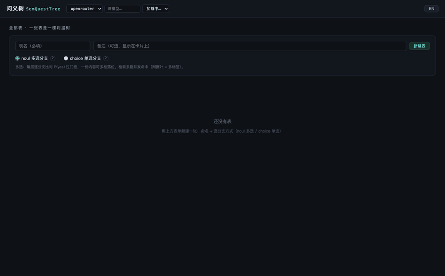

# 会自己长大的判据树 —— SemQuestTree 自生长实录



> 种下两枝判据，倒进 50 条真实生活语料，看着它自己长成一棵最深四层、二十多个类别、
> 带完整判定轨迹与 token 账单的心智地图。上面这段 GIF 是一次完整实录，全程无人工修树。

---

## 0. GIF 分镜：60 秒看懂发生了什么

| 分镜 | 画面 | 背后发生的事 |
|---|---|---|
| 空树 | 只有一个 ROOT | 新建表「我的记忆」，noul 多选模式 |
| 种两枝 | 右键 ROOT → 加「工作与学习」「生活与家庭」 | 判据 = 类别含义（yes 是含义列举，no 是反例），人工只做这一次 |
| 批量导入 | 50 条分 10 片提交，进度条 0→100% | 每条逐层过决策模型落位；每片完成树侧计数即时刷新 |
| 🌿 生长事件 | 导入区冒出「xx 下长出新枝」 | 树接不住的内容（落兜底）当场催生新枝并收编 |
| 延伸条（自动） | 「生活与家庭」延伸完成：新枝 3 · 迁入 24 | 叶存量超水位 → 后台自动拆细，不阻塞导入 |
| 延伸条（手动） | 逐个右键 docCount>3 的叶 → 延伸拆细 | 子女成长 / 长辈与养老 / 开发框架 … 一层层长到第 4 层 |
| 检索 | 「用户用什么技术栈开发电商项目」 | 判据逐层下探 0.97→0.91→0.82，命中「后端语言」叶，文档按命中叶数排序 |

---

## 1. 建树过程：人工只种两枝，剩下的交给数据

**第一步 · 种子判据（人工的最后一次劳动）**

| 分支 | yes（类别含义） | no（反例） |
|---|---|---|
| 工作与学习 | 编程语言，开发框架，数据库与中间件，压测与性能，团队管理，技术会议与评审，面试招聘，通勤，学习计划与技术认证 | 家庭事务，孩子教育，父母长辈，饮食出游，房产家务，宠物 |
| 生活与家庭 | 婚姻与夫妻，孩子与教育，父母长辈，宠物，健身与饮食，房产与家务，家庭惯例与出游 | 编程技术，工作团队，会议面试，学习认证 |

**第二步 · 批量导入 50 条**

前端把语料按 5 条一片分片提交（`addBatch` 带实时进度条），服务端逐条做逐层判定落位。
每条内容的判定轨迹全程留痕——哪个层、哪个分支、P(yes) 多少、耗时与 token，全部可回放：

```
@ROOT      工作与学习 0.97 · 效率工具 0.00 · 汽车与出行 0.00 …   [920ms · in 397 / out 7]
@工作与学习  开发框架 0.91 · 日常会议 0.00 · 通勤出行 0.00 …     [974ms · in 225 / out 4]
@开发框架   后端语言 0.82 · 微服务组件 0.25                    [979ms · in 124 / out 2]
```

**第三步 · 实录账单（这一步全部真实发生）**

| 阶段 | 模型请求 | tokens | 耗时 |
|---|---|---|---|
| 50 条批量导入 | 判定 66 次 | in 12,386 / out 180 | 100 秒（含 5 次落兜底生长） |
| 自动+手动延伸 ×6 | 生成 6 次 + 重判 122 次 | 生成 in 7,700 / out 652 | 11~94 秒/次（后台，不阻塞） |
| 检索 ×2 | 判定 6 次（逐层 × 2 问） | in 1,492 / out 26 | 2.9 / 4.8 秒首查 |

最终树形：ROOT 8 个分支（5 个是自生长出来的），**最深长到第 4 层**，28 个叶、20+ 判据节点；
50 条零丢失（52 个落位 = 2 条多重命中语义叶，noul 多选特性），其中 43 条归入语义叶、9 条留在路径兜底叶。

---

## 2. 自生长：宽度生长 + 深度生长

### 2.1 落兜底即生长（宽度）

一条内容在现有分支全部过不了门控（P < 0.7）→ 落兜底 → **同步**调生成模型：
「这一层现有分支是 …，这条内容是 …，提出至多 N 个新分支让它有家可归」。
新枝入树后立刻**全量重判**验收——触发这条内容被收编进新枝才算数，没收编就整枝回滚、内容原位不动。
GIF 里 ROOT 层的「汽车与出行」「医疗健康」「效率工具」「居住成本」「社交与聚会」就是这么长出来的。

### 2.2 节点延伸（深度）

一个叶子的存量超过水位（`splitAt × splitFactor`，本演示 3×1.0=3 条）→ **后台单工线程**串行拆细：

```
锁内快照 planExtend → 锁外生成 1 个更细子类 → 锁内 addNode
→ 存量逐条重判（锁外调模型 + 锁内短临界区迁移）→ 轮末落盘 → 下一轮
```

- **双触发**：水位自动（add 落位后检查）/ viz 右键手动（强制拆细，不受水位限制）
- **多层递归**：延伸提示词与层级无关（只约束「比父节点细一层」），二三四五层同一套模板复用，零代码分支
- **自纠错**：每轮新枝若 0 条存量被收编 → `undoGrow` 整枝回滚，数据零丢失；本次实录 6 轮延伸 **0 回滚**
- **不阻塞**：延伸跑后台，期间 add/quest 照常服务；前端进度条实时展示轮次与迁移数

实录中「生活与家庭」叶 34 条 → 3 轮拆出「子女成长(11)」「长辈与养老(6)」「个人健康与爱好(7)」等新枝，
迁移 24 条；随后手动延伸继续把「子女成长」拆出「教育培养」「家庭照料」，再把「亲子陪伴」拆出
「家庭出游」「家庭聚会」——**实录最深自动长到第 4 层**，全程同一套延伸模板，零代码分支。

---

## 3. 容量与时延

**容量**：判据树按层组织，单层分支护栏可调（`growth.maxBranches`，上限 255）。
按三层、单层 255 分支计，编址空间 **255³ ≈ 16,581,375 个类别节点**；每个叶的存量由水位自动拆细，
**文档总量没有硬上限**——树会长到接得住为止。深度同样不设限：本实录在水位=3 下自动长到了第 4 层。

**时延（本实录实测，决策模型 microsoft-decision-1）**：

| 操作 | 时延 | 说明 |
|---|---|---|
| add 单条落位 | ~1.3s/次判定，单条约 2s | **add 稍慢是有意的**：落位本身就是抽取过程——每层每个分支都要过一次决策模型判「这条内容是否属于此类」。慢在抽取，不在存储 |
| add 落兜底生长 | +3~6s | 生成模型提新枝（`growth.thinking=none` 时），验收重判另计 |
| quest 首查 | 2.9~4.8s（逐层 3 判定） | 逐层判据判定；同 query 命中缓存后**零模型直返**（`questCacheSize`） |
| 延伸一轮 | 11~94s | 生成 1 次 + 存量重判 N 次；后台串行，主链路无感 |

值得强调：**写入慢换来了查询免维护**——没有嵌入向量要重建、没有索引要调优、没有分词器要训练；
判据是自然语言，人能读、能改、能审计。

---

## 4. 成本：一次判定 ≈ 0.0001 刀

- 实测口径：**75 次模型请求合计约 $0.01**，即单次 ≈ $0.00013
- 本演示全流程（50 条导入 + 6 轮延伸 + 2 次检索）共约 200 次请求、~34k tokens，折合约 **$0.03**
- 本次演示自始至终一套配置：**决策 microsoft/microsoft-decision-1 · 生成 qwen/qwen3.7-flash**，效果即上方 GIF；判定走
  OpenRouter decisions 端点按 token 计费，本量级几乎可忽略

---

## 5. 模型兼容：生成侧对 OpenRouter 全量开放

| 角色 | 端点 | 本演示所用 | 说明 |
|---|---|---|---|
| 决策（判定 P(yes)） | openrouter `alpha/decisions` | `microsoft/microsoft-decision-1` | 也可切 jev / mock（零凭据确定性后端，测试用） |
| 生成（长新枝/延伸判据） | openrouter `chat/completions` | `qwen/qwen3.7-flash` | **任意 OpenRouter chat 模型即插即用**，改一行 `growth.model` 即换 |

自生长链路对生成模型的全部要求只有一条：按提示词输出 `{"branches":[{"name":"…","yes":"…"}]}` 的 JSON。
因此 OpenRouter 上任意 chat 模型都可顶上——上图效果即由 qwen/qwen3.7-flash 生成；`growth.thinking` / `growth.maxTokens`
提供推理力度与输出上限护栏。

---

## 6. 定位：自生长路由器 · 分类器 · 记忆中间件

SemQuestTree 不是又一个向量库。它是一棵**用自然语言判据组织、按数据自己生长**的树：

| | 向量库 RAG | 传统分类器 | SemQuestTree |
|---|---|---|---|
| 类别体系 | 无（近邻即答案） | 人工预定义、固定 | **种子 2 枝起步，数据驱动长出全树** |
| 可解释性 | 相似度分数 | 特征权重难读 | 每步 P(yes) + 判据原文，全链路可审计 |
| 新类别出现 | 无类别概念 | 需重新训练 | **落兜底当场长出新枝** |
| 层级 | 平面 | 平面或人工 | 自动多层（水位触发逐层拆细） |
| 冷启动 | 需嵌入模型 | 需标注数据 | 两句话判据即可 |
| 查询 | 近邻搜索 | 前向推理 | 自然语言下探 + 命中叶排序，可缓存 |

三个身份：

1. **自生长路由器**——任何「进来一条，路由到该去的地方」的场景：工单分派、笔记归档、需求池整理。
   类别体系不用预先设计，长出来。
2. **自生长分类器**——门控 + 兜底 + 验收回滚，分类边界永远可解释、可回滚。
3. **记忆中间件**——给应用装一个会自己整理的大脑：随手写入（add），要用时语义下探检索（quest），
   夜里后台延伸加固（extend）。记忆不是堆着的，是长着的。

---

## 7. 下一步：MCP，让 Agent 长出这棵树

把四个 HTTP 端点包成 MCP tools，任何 Agent 即插即用：

```json
{ "memory_add(content)": "写入一条记忆，树自动落位、必要时生长",
  "memory_quest(query)": "语义下探检索，返回相关记忆与判定轨迹",
  "tree_grow(parent)": "在某层主动催生新分支",
  "node_extend(node)": "手动触发某节点拆细" }
```

设想的工作流：Agent 白天在对话中随手 `memory_add`（毫秒级挂起，不阻塞对话）；
夜间任务定时 `node_extend` 把白天拥挤的叶拆细——如同大脑睡眠期的记忆巩固；
第二天 Agent 的检索面对的已是一棵重新整理过的树。
当多个 Agent 共享一张表，这棵树就是它们的**公共长期记忆**：判据是自然语言，
Agent 能读、能提议、能投票——记忆的生长第一次变得可协作、可审计。

---

## 附 · 复现这个演示

```bash
mvn -q compile
mkdir -p /tmp/sqt-demo && cd /tmp/sqt-demo
cp $REPO/semquest.properties .        # 填入你的 openrouter.apikey
cp $REPO/viz.html .
# 关键配置：
#   backend=openrouter  openrouter.model=microsoft/microsoft-decision-1
#   growth.enabled=true  growth.model=qwen/qwen3.7-flash
#   growth.splitAt=3  growth.splitFactor=1.0   ← 水位=3，>3 条即触发延伸
#   growth.extend.maxNew=3  growth.thinking=none
java -cp $REPO/target/classes org.example.SemQuestServer   # http://localhost:8787
```

打开 viz → 新建表 → 右键 ROOT 种两枝 → 控制台切「批量」→ 粘贴 [demo-corpus.txt](demo-corpus.txt)（空行分隔）→ 看它长。

录制与合成脚本（git 忽略，不入库）：`target/demo-record.py`（playwright 截帧）、`target/demo-compose.py`（PIL 合 gif）。
